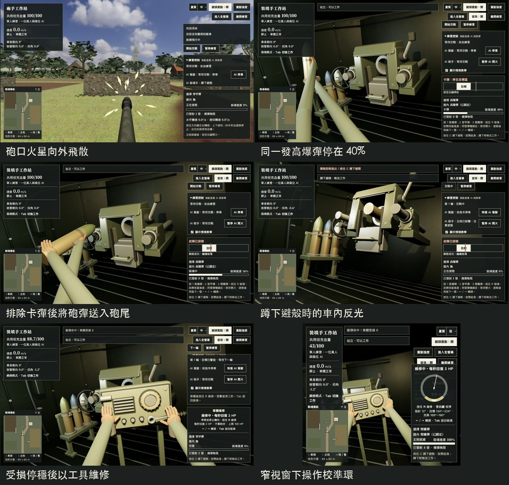

# 主炮與裝填手工作區驗證

2026-11-19 以 Codex 內建瀏覽器進入「單人練習」，在整合版 `6fcc232` 輪流操作砲手、裝填手與駕駛。使用一個遊戲畫面、遊戲內的 AI 隊友、正常鍵盤和公開儀表。對照 1280 × 720 中畫質與 720 × 650 窄視窗；窄視窗的維修與校準另以低畫質進行。

[有聲試玩短片](media/loader-playtest.mp4) 保留各段實際播放速度與遊戲聲音。[校準結果原聲](media/loader-calibration.m4a) 依序為一般成功、完美成功、失敗。音效以瀏覽器送往音訊輸出的錄音、波形及頻率核對；實體喇叭的聽感留待人工確認。

| 票 | 單人練習觀察 |
| --- | --- |
| #69 主炮 | 同砲位連開兩發，計數 4 → 5 → 6，各自有一次砲口短閃，火星分開向外飛散再消退。駕駛的裝甲觀察窗保留遮蔽。裝填時蹲下和維修時站立都看得到瞬間的車內反光，退殼文字可讀。關閉鏡頭震動後也重現維修視角的反光。 |
| #70 環視與提示 | 站姿及蹲姿往兩側看仍在封閉車內，鬆鍵後回到工作朝向。R 與方向鍵同按時，穿甲彈從 0% 裝到 48%；維修中同按則從 95.8 回到 100 HP。720 × 650 下，側面的卡彈目標與校準儀表可讀。換工作及單人暫停往返已操作；作業系統離焦未單獨驗證。 |
| #71 取彈與閉鎖 | 手套從彈架取出高爆彈，沿砲身托送、推入砲尾後收手。放開 R 停在 25%，選其他彈種、蹲下、切到機槍與維修再回來，膛內仍鎖定原高爆彈。續裝到 100% 時閉鎖，錄音中可分辨間隔約半秒的滑動短聲及末段閉鎖瞬音。另完成穿甲彈及煙霧彈裝填。 |
| #72 卡彈與退殼 | 40% 卡住時手與砲彈停在原位。區外按空白鍵顯示未命中、一秒倒數，區內命中後可續裝。第一發按 C 躲過彈殼並能裝下一發；第二發在維修站站立，被彈殼擊中並顯示五秒暈眩。兩次都錄到退殼聲與警示，站立受殼另有低音警告。 |
| #73 維修工具 | 遭敵彈打到 88 HP 後，在停穩車體上按 R，可見左手扶面板、右手操作工具。鬆鍵時血量停在 90.6，續按才回升。蹲下同按 R 時維持 95.8，起身再修至 100 後收手。獨立錄下的 1.49 秒基本維修片段沒有工具敲擊聲。 |
| #74 校準 | 右手從工具移向調整環。窄視窗下在 252° 確認（目標 249°–339°）得到一般成功與額外 +1 HP，在 171° 確認（完美區 169°–190°）得到完美與額外 +3 HP。區外按鍵與漏按均顯示失敗、停修兩秒。結果錄音分別為兩個上行音、三個上行音與兩個下行音。單人暫停與恢復後均為 16°、60.7 HP，重新按 R 才續接；放開時指針在 102° 中斷，顯示失敗。 |
| #75 三人房 | 依使用者決定保持待驗。仍需三台裝置、三位玩家比對同一發射擊、共用血量、缺員暫停及原職重連。 |

**試玩發現**

- 砲手視角連續兩發的遊戲聲道均為靜音。同一局的裝填手聲道可錄到裝填、退殼與校準。若要讓砲手聽見自己的主炮，目前仍缺這個回饋。
- 1280 × 720 預設朝向裝高爆彈時，40% 卡彈姿勢的彈尖部分進入左上半透明資訊框。承托的手、彈身、砲尾與右側卡彈指針仍可見。上圖保留當時的完整畫面。

## 工作區構圖

以下是固定站姿與預設朝向的 Three.js 投影，單位為 CSS 像素，X 從畫面左側起算。取樣使用遊戲的手部姿勢、檢修模型、相機縮放與工作朝向。工具範圍來自四秒工作循環的網格頂點，每 0.02 秒取樣一次。

| 畫面 | 高爆彈裝填 45%／55% 的右腕 X | 基本維修工具 X 範圍 | 校準 0.4 秒，調整環中心／右腕 X |
| --- | --- | --- | --- |
| 1280 × 720 | 215／243 | 725–928 | 751／795 |
| 720 × 650 | 230／241 | 323–429 | 336／361 |

720 × 650 的右側工作欄從約 X = 499 開始。修正前，同一支裝填右腕在 45% 時出框至 X = −23，55% 時仍在 X = 2。修正後，45% 時砲彈兩端落在 X = 214–265。1280 × 720 保留原本 58° 垂直視角。這些座標用來檢查取景；實際遮擋與聲音見上方試玩紀錄。

## 正式三人房

從私人房間以三個職位參加，使用專案原有的 PeerJS／WebRTC 連線與主機判定。既有案例提供操作與觀察項目：

- 外景可依[正常開火錄影案例](../tests/tank-review-flash.spec.ts)及[三職位震動與重連案例](../tests/tank-crew-motion-integration.spec.ts)確認同一發射擊，另於裝填及維修視野觀察反光。
- 裝填、卡彈、退殼與暈眩可沿用[卡彈](../tests/tank-jam.spec.ts)、[退殼](../tests/tank-ejection.spec.ts)與[職位重連](../tests/tank-reconnect.spec.ts)的操作，再加入裝填手轉頭與側邊提示。
- 真實受損、駕駛停車、校準和工作中斷可沿用[維修生命週期](../tests/tank-repair-lifecycle.spec.ts)與[三方校準](../tests/tank-repair-calibration.spec.ts)的操作，核對畫面、聲音與全車 HP。
- 此版的輕量檢查與建置結果見[本輪交接](agents/current-task.md)。案例收集不代表執行上述連線流程。
